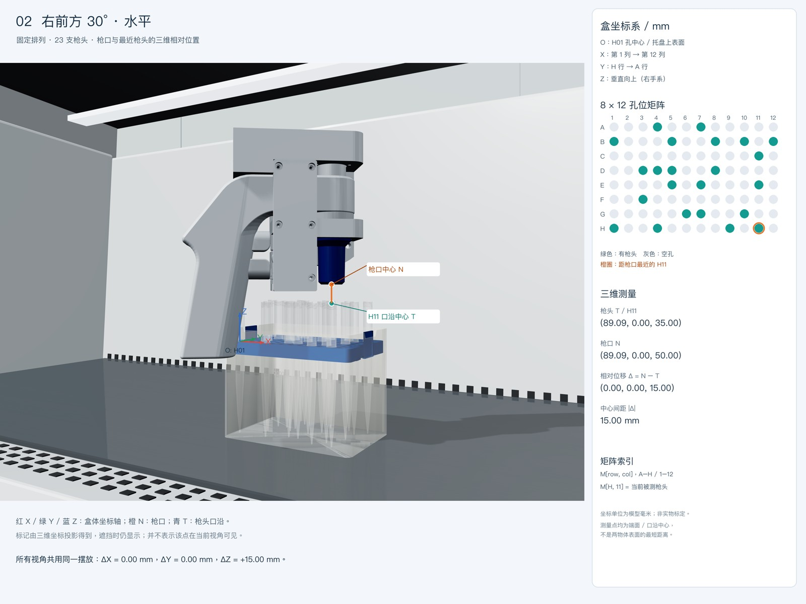

# 实验室器材合成图像：渲染与坐标标注说明

目标是生成固定场景下的偏水平多视角图片：电动助吸器蓝色枪口位于2000 μL枪头盒上方，每张图附坐标轴、8×12孔位矩阵、最近枪头及三维相对位置。几何与投影来自实际场景，不用图片生成模型猜测位置。



## 当前固定基线

当前材质为半透明蓝色枪头＋红色托盘（2026-11-09更新）。实物图片来源、色值和透明度见 [配色参考](rendering/COLOR_REFERENCE.md)。原有训练集仍使用旧配色。

蓝色枪头配色的数据生成和模型微调流程见 [dataset_v2](rendering/dataset_v2/README.md)：4,000张图片，强化平视和密集排列，保留独立测试集并比较微调前后效果。

- 2000 μL枪头盒，无盒盖；每支枪头口沿六道浅环纹。
- 96个孔位中保留23支，具体占用以 `rendering/scenes/horizontal.json` 为准。
- 使用用户提供的新版电动助吸器模型，保留蓝色枪口。
- 枪口端面中心对准H11枪头口沿中心，轴向间距15 mm。
- 只移动相机，不重新随机排列、不移动器材、不改变材质。
- 原始图3840×2880；标注版同尺寸，左侧缩放展示原图，右侧是数据面板。
- 当前“移液管”指蓝色枪口；场景未包含单独的长移液管。

## 一次配置

在仓库根目录执行（Python 3.10+）：

```sh
python3 -m venv .venv
source .venv/bin/activate
python -m pip install -r rendering/requirements.txt
python -m playwright install chromium
```

标注需中文字体。macOS默认使用 `/System/Library/Fonts/PingFang.ttc`；其他系统设置 `ANNOTATION_FONT` 为可读取的中文字体文件，如 Noto Sans CJK。字体未随仓库分发。

## 重现图片

终端1，仓库根目录：

```sh
python3 -m http.server 8792 --bind 127.0.0.1
```

终端2，仓库根目录，激活上述环境：

```sh
python rendering/scripts/render.py
python rendering/scripts/annotate.py
```

默认打开 `http://127.0.0.1:8792/rendering/engine/`。如需修改端口设置 `RENDER_URL`。可用 `CHROME_PATH` 指定本机Chrome可执行文件；未设置时用Playwright Chromium。`RENDER_OUTPUT` 可指定输出目录（建议绝对路径），两个脚本须使用同一个目录。

最终结果在 `rendering/output/horizontal_annotated_views.zip`。包含原始PNG、带标注PNG、相机JSON、每视角测量JSON、孔位坐标矩阵、原场景和验证结果。输出目录被Git忽略，避免大量4K图反复进入版本历史。

## 坐标定义

使用右手盒坐标系，单位毫米：

- O：H01孔中心投影到托盘上表面的点。
- X：第1列 → 第12列。
- Y：H行 → A行。
- Z：垂直向上。

Three.js世界坐标单位是米，Y向上。对世界点 `(wx, wy, wz)` 和原点 `(ox, oy, oz)`：

```text
X = 1000 × (wx - ox)
Y = 1000 × (oz - wz)
Z = 1000 × (wy - oy)
```

本基线盒体无旋转。该公式不自动支持任意旋转盒体；若修改盒体旋转，必须改为从盒体变换矩阵提取坐标轴，再更新投影与验证。

矩阵按A–H行、1–12列排列。JSON数组从0起算，`occupancyMatrix[7][10]` 为H11；有枪头=1、空孔=0。`holeCoordinateMatrixMM` 是8×12×3孔位坐标矩阵，孔位Z=0，枪头口沿中心则约Z=35 mm。

当前参考值：

| 点 / 向量 | X mm | Y mm | Z mm |
|---|---:|---:|---:|
| H11枪头口沿中心T | 89.09037 | 0 | 35.00000 |
| 枪口端面中心N | 89.09037 | 0 | 50.00000 |
| Δ=N−T | 0 | 0 | 15.00000 |

最近枪头按23个实际存在的口沿中心与枪口中心的三维欧氏距离计算。这里不是物体表面之间的最短距离，也不是二维图片中的距离。

## 必须遵守的修改规则

1. 默认保持基线器材位置、23支占用、无盖、口沿细纹、材质及15 mm间距不变；新视角只改相机列表。
2. 高度参考是枪口端面，不是手柄或整机包围盒最低点。
3. 更换模型后重新检查单位、朝向、枪口端面和资产文件。当前枪口GLB源坐标为 `(0.05425, -0.058, 0)` 米；不得盲用于其他模型。
4. 标注点通过相机矩阵投影，禁止手工拖动到“看起来正确”的位置。
5. 遮挡时仍显示测量标记，图片明确说明这一点；没有进行可见性射线检测。
6. 记录原图像素坐标与标注图像素坐标，不能混用。标注原图缩放0.725倍，偏移 `(0,300)` 像素。
7. 生成后检查所有视角、读取验证JSON，并核对照片和相机JSON尺寸一致。

## 质量边界

参数是参考实物视频后的视觉近似，非光学或计量标定。透明件采用alpha混合和经验角度项，不是完整折射、体积散射或路径追踪；复杂叠加可能出现排序问题。细环纹尺寸也是视频近似。不同GPU/Chrome版本可能造成细微像素差异。加入助吸器后如细节变小，应增加像素预算或收紧构图，不应擅自更改枪头材质。

详细实现、字段和验证见 [rendering/PLAN.md](rendering/PLAN.md)。旧编辑器使用说明保存在 [editor-instruction.md](editor-instruction.md)。

## 随机化训练数据模式

用户已授权单独生成包含不同光照、透明度、占用、器材位置和相机视角的训练数据。此模式使用 [rendering/dataset/README.md](rendering/dataset/README.md) 的生成器，不覆盖上述固定场景。首批共2,000张，按场景分组为1,600/200/200张训练/验证/测试图。训练图不带标注文字；物理口沿中心的投影保存在独立标签中。像素坐标u向右、v向下，目标Δ=(枪口u−枪头u, 枪口v−枪头v)。

随机模式使用盒体变换后的世界坐标投影，不能直接套用固定基线无旋转的坐标换算公式。训练采用两类单关键点YOLO，测试报告包括漏检和Δ像素误差；任何合成测试结果均不能替代真实照片验证。
