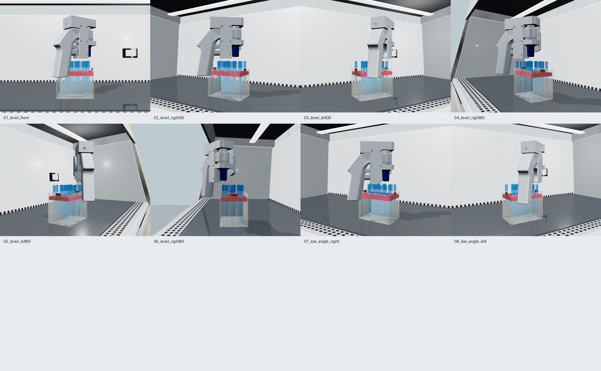

# 蓝色枪头与红色托盘

2026-11-09按用户要求更换默认配色。参考产品照片的颜色和塑料质感，保留现有2000μL网格、透明外壳、无盖、口沿细纹及固定场景排列。

## 实物参考

- [Biologix蓝色1000μL枪头](https://biologixeurope.com/products/biologix-universal-pipet-tips-1000ml-blue-100-pieces-rack-6-racks-pack-10-packs-case)：参考半透明蓝色枪头，薄壁透光、重叠处颜色加深。照片对应1000μL产品，仅用于配色参考，不据此改变当前几何尺寸。
- [Anders / Ratiolab 11250-R](https://anders-laborshop.com/p/pipettenspitzen-im-rack-typ-eppendorf-blau-bis-1200-l)：参考红色注塑塑料质感。该产品为60位盒，与当前96位几何不同；只把当前原蓝色托盘及卡扣改红，不照搬参考盒结构。

## 参数

| 材质 | 色值（sRGB） | 基础alpha | 粗糙度 |
|---|---|---:|---:|
| 枪头 | #1684cf | 0.42 | 0.21 |
| 口沿细纹 | #1684cf | 0.55 | 0.24 |
| 托盘及卡扣 | #c51625 | 1.00 | 0.40 |
| 外壳 | #e4e3d5 | 0.38 | 0.46 |

枪头保留原有角度相关alpha项；基础alpha不是透光率实测值。参考图片的灯光与白平衡未知，因此这是视觉近似。

`appearance.setPalette('blue-tips-red-tray')` 为当前默认；`clear-tips-blue-tray` 可恢复原配色。保存场景和相机导出记录palette与实际色值。未记录palette的旧场景使用当前默认配色。

既有v1数据生成器显式选择旧配色，确保其结果可复现；此前2,000张数据和训练指标仍属于旧配色，不代表蓝色枪头的识别表现。

本次生成8个3840×2880视角，自动验证23支枪头、器材变换未改变、枪口与H11口沿轴向间距15mm且横向对齐。

