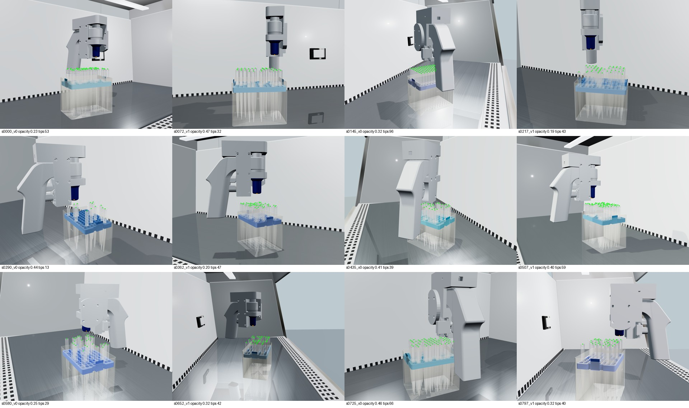

# 随机场景关键点数据集 v1

本流程在同一套源mesh上生成2,000张无标注RGB图和口沿中心标签。和固定场景演示不同，它改变场景本身：1,000个场景，每个2个视角。训练/验证/测试按scene_id分组，分别1,600/200/200张。

## 随机化范围

- 枪头基础alpha 0.12–0.52，粗糙度0.15–0.38；盒身alpha 0.20–0.52。
- 占用约8–70支，部分场景满96支；总是保留一个边缘目标孔。
- 枪口与目标口沿高度差6–45mm，盒平面内偏移X ±6mm、Y ±5mm。
- 盒体平移、绕竖直轴旋转；助吸器绕竖直轴变化，手柄朝盒外。
- 相机方位约±95°、距离0.32–0.50m、FOV38–50°；近水平至斜上方。
- 主光位置、强度、偏暖颜色，补光强度和曝光0.5–0.95。

此版本不改变源mesh形状，不等于跨品牌、跨背景或实拍数据集。材质参数仍为视觉近似。

## 标签定义

类别0=`tip_opening`，类别1=`nozzle_opening`；每个实例一个关键点，分别为口沿中心、枪口端面中心。检测框仅覆盖口部局部，不是整支枪头/整台助吸器的框。

YOLO pose文本格式：`class xc yc width height kx ky visibility`，坐标按1280×960归一化。visibility=2为可监督中心；0为未监督。所有几何中心和物体ID保存在metadata中。

实例ID渲染把透明件暂时按不透明表面处理，采样16个口沿点。至少25%投影附近能读到本实例ID才监督关键点。该判据只是透明场景下的保守可见性代理，不是实物可见性真值。助吸器白色机身被当作遮挡物，仅蓝色枪口使用枪口实例ID。

## 生成

启动仓库根目录HTTP服务器，安装根instruction.md中的渲染依赖后：

```sh
python rendering/dataset/generate.py
```

默认写入 `rendering/dataset/output/`；可用 `DATASET_OUTPUT`、`RENDER_URL`、`CHROME_PATH` 覆盖。默认SCENE_COUNT=1000；少于801的试跑只会生成训练集，不能直接用于完整训练。可以恢复中断任务，但更改生成器或随机规则后必须使用新的输出目录，避免混合版本。

完整数据集须检查场景划分不交叉、标签坐标有效、文件数、图片哈希去重和随机抽样叠加图。manifest.json记录实际生成批次的计数。

## 训练与评分

服务器训练使用独立目录、YOLO26n-pose预训练模型、2类别/1关键点，Ultralytics 8.4.183。`train_pose.py`与`evaluate_pose.py`放在包含images/、labels/、metadata/、dataset.yaml和yolo26n-pose.pt的数据目录执行。

示例dataset.yaml：

```yaml
path: /absolute/path/to/dataset
train: images/train
val: images/val
test: images/test
names:
  0: tip_opening
  1: nozzle_opening
kpt_shape: [1, 3]
flip_idx: [0]
```

训练50轮上限、patience=12、960输入、batch24，关闭mosaic和翻转。最佳权重只按验证集选取。运行后对未用于调参的200张测试图评估。

指标包括单点误差、Δx/Δy MAE与偏差、Δ向量L2误差分位数、有效配对覆盖率和2/5/10px成功率。成功率分母包含未检测的符合可见性条件的配对。匹配使用同类别框IoU≥0.3的匈牙利算法，属于离线评分，并不证明模型已经能独立给每支枪头分配A01–H12孔位。实际部署还需孔阵列定位和身份匹配。

数量是否足够需要数据量对照及独立真实图像验证；2,000张仅为首批实验，不是充分性的证明。

## 首批实验产物

实际指标见 [RESULTS.md](RESULTS.md)，机器可读统计见 `results_1600.json`、`results_400.json` 和 `failure_groups_1600.json`。分组分析脚本 `analyze_failure_groups.py` 放在数据目录下运行，读取 `evaluation/predictions.json` 与测试metadata。低opacity指更透明，高opacity指更不透明。



上图为检查标签用的预览；训练输入为不带点、不带文字的RGB图。完整图片、权重不纳入Git历史。原始归档哈希记录在结果报告中。

复现400张对照时，将 `prepare_400.py`、`train_400.py` 和 `evaluate_400.py` 放入完整数据目录，依次运行。前者选取场景0–199的400张训练图，验证/测试集不变。与完整数据训练使用相同轮数，但每轮优化步骤不同；此对照不控制总计算量。
