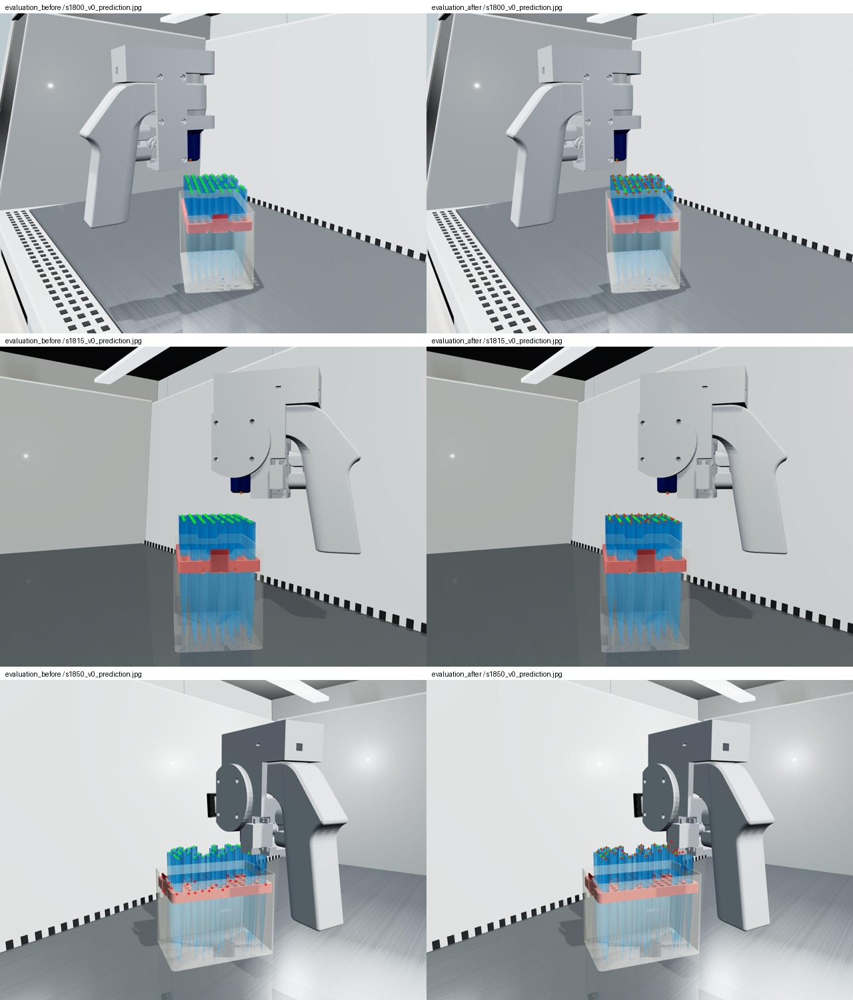

# 蓝色枪头／红色托盘微调结果

新生成4,000张RGB图、2,000个场景，按场景隔离为3,200/400/400张训练/验证/测试图。使用独立场景和相机种子，约50%密集排列，并提高近水平视角覆盖。从v1的1,600图模型微调，上限30轮，仅依据验证集选择权重。

## 同一组400张新配色测试图

| 指标 | 微调前 | 微调后 |
|---|---:|---:|
| 配对覆盖率 | 4.60% | 61.62% |
| 5px内成功率，包含漏检 | 4.04% | 55.49% |
| 三维最近枪头配对5px内成功率 | 7.83% | 81.85% |
| Δ向量误差中位数，成功配对时（px） | 2.58 | 2.06 |
| Δ向量误差P90，成功配对时（px） | 5.34 | 4.98 |
| Δu平均绝对误差，成功配对时（px） | 1.70 | 1.74 |
| Δv平均绝对误差，成功配对时（px） | 2.03 | 1.52 |

## 原配色200张测试图

包含漏检的5px内成功率：微调前 65.26%；微调后 65.00%。

原配色的三维最近枪头配对5px内成功率从86.90%降至79.31%，因此不能说所有旧配色指标都保持不变。

## 检测与交付

在新配色测试集上，枪头检测框共有20,467个GT目标。微调后预测12,806个，按同类别IoU≥0.3匹配12,539个，对应框精确率97.91%、召回率61.26%；主要不足仍是漏检。此框指标与中心可见性筛选后的关键点指标分母不同。

训练完成30轮，总耗时约650.5秒。最终权重SHA256：`803afc629cf4c5b511d6261e3cc2de1cdd621c548bc2c6c091c399de4fecdaed`。基模型和数据集哈希记录在RUN_CONFIG.json。

单张验证图推理脚本已实测，输出28个枪头、1个枪口和28组Δu/Δv，并校验了坐标差的方向和数值。预测编号不是A01–H12孔位编号。

对比图左列为微调前、右列为微调后；绿色圆点为GT，红色十字为预测。检测误差和可见性误差仍需在真实照片上验证。

## 适用范围

像素误差均在1280×960原图坐标下计算。GT辅助匹配只用于离线评分，并非实际孔位身份识别。遮挡对象不保证可识别。不透明代理可见性不是真实光学可见性。尚未测量实拍准确率；仅一个训练种子、同一组网格与背景。微调前后成功配对数量不同，仅看成功配对误差会有选择偏差，应同时比较包含漏检的成功率。

数据集SHA256：e73fdf48acb30d3344542390f52a680a189dc3b6aeead142122e83d4b401660c

## 微调后困难场景

| 分组 | 图片数 | 配对覆盖率 | 5px内成功率（含漏检） |
|---|---:|---:|---:|
| 近水平（<5°） | 231 | 48.17% | 44.14% |
| 较高视角 | 169 | 75.41% | 67.14% |
| 密集排列 | 194 | 56.04% | 49.75% |
| 稀疏排列 | 48 | 87.88% | 83.67% |
